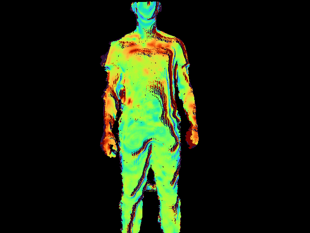
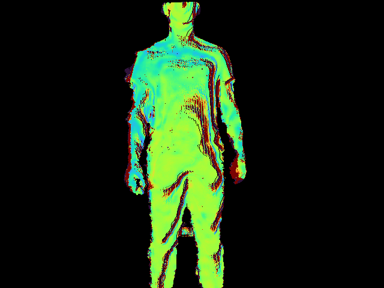
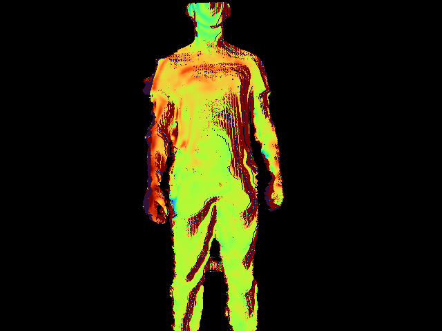
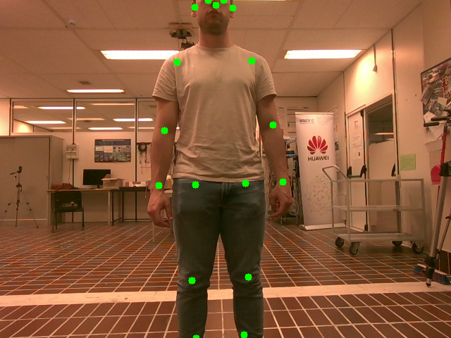
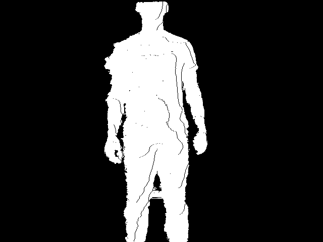

# Respiratory Motion Extraction from RGB-D Videos

<p align="center">
  
  
  
</p>

<p align="center">
Automatic extraction and visualization of respiratory motion from RGB-D video sequences using YOLO pose estimation and temporal depth filtering.
</p>

---

## Overview

This project estimates subtle respiratory motion from RGB-D video sequences using human pose estimation and depth sensing.

The pipeline uses a YOLO pose model to automatically locate the subject's torso, extracts depth measurements from the torso region, applies temporal filtering, and visualizes small depth variations associated with breathing.

### Applications

- Contactless respiration monitoring
- Biomedical signal analysis
- Human motion analysis
- RGB-D computer vision research
- Remote physiological sensing
- Healthcare-oriented computer vision

---

## Method

### 1. Human Pose Detection

A YOLO pose estimation model is used to detect body keypoints from the first RGB frame.

Detected landmarks include:

- Shoulders
- Hips
- Elbows
- Wrists
- Knees
- Ankles

The torso ROI is defined by:

- Right Shoulder
- Left Shoulder
- Left Hip
- Right Hip

### 2. Torso Region Extraction

A polygon mask is created from the detected landmarks. The median torso depth is computed and used to isolate pixels belonging to the subject.

### 3. Temporal Depth Processing

A Butterworth band-pass filter is applied independently to each torso pixel through time.

Parameters:

- Sampling frequency: 15 Hz
- Passband: 0.1–1 Hz
- Filter order: 2

This range captures typical respiratory frequencies while suppressing static and high-frequency noise.

### 4. Respiratory Visualization

Filtered depth variations are mapped to a Turbo colormap to visualize breathing-induced chest and abdominal motion.

---

## Processing Pipeline

```text
RGB Video
    |
    v
YOLO Pose Estimation
    |
    v
Torso Landmark Detection
    |
    v
Depth ROI Extraction
    |
    v
Temporal Band-Pass Filtering
    |
    v
Respiratory Motion Map
    |
    v
Visualization and Video Export
```

---

## Results

### 1. YOLO Pose Estimation

<p align="center">
  
</p>

YOLO Pose automatically detects body landmarks used to define the torso region of interest.

### 2. Subject Segmentation

<p align="center">
  
</p>

Depth-based segmentation isolates the subject from the background using the torso depth estimate.

### 3. Respiratory Motion Maps
<p align="center">
  
  
  
</p>

Representative respiratory motion maps obtained after torso segmentation and temporal band-pass filtering. The color distribution highlights subtle depth changes associated with respiration.

### Interpretation

- Warm colors correspond to positive depth displacement.
- Cool colors correspond to negative depth displacement.
- Background pixels are removed using depth- and pose-based masking.
- Respiratory activity is enhanced through temporal filtering.

---

## Requirements

python version 3.9. 
```bash
pip install -r requirements.txt
```


---

## Input Data
Right now not present. 
```text
depth_video_subject/
├── color_data.npy
└── depth_data.npy
```

RGB:

```python
(F, H, W, 3)
```

Depth:

```python
(F, H, W)
```

---

## Running

```bash
python main.py
```

Generated outputs:

```text
video_color.mp4
video_colormap.mp4
depthvideo.mp4
```

---

## Acknowledgments

This project uses the Ultralytics YOLO Pose framework for skeleton extraction and body keypoint localization.

- https://github.com/ultralytics/ultralytics
- https://docs.ultralytics.com/

---

## License

### This Repository

MIT License.

### Third-Party Software

This project depends on the Ultralytics YOLO framework, licensed under AGPL-3.0.

For details:

- https://www.ultralytics.com/legal/agpl-3-0-software-license
- https://github.com/ultralytics/ultralytics/blob/main/LICENSE

---

